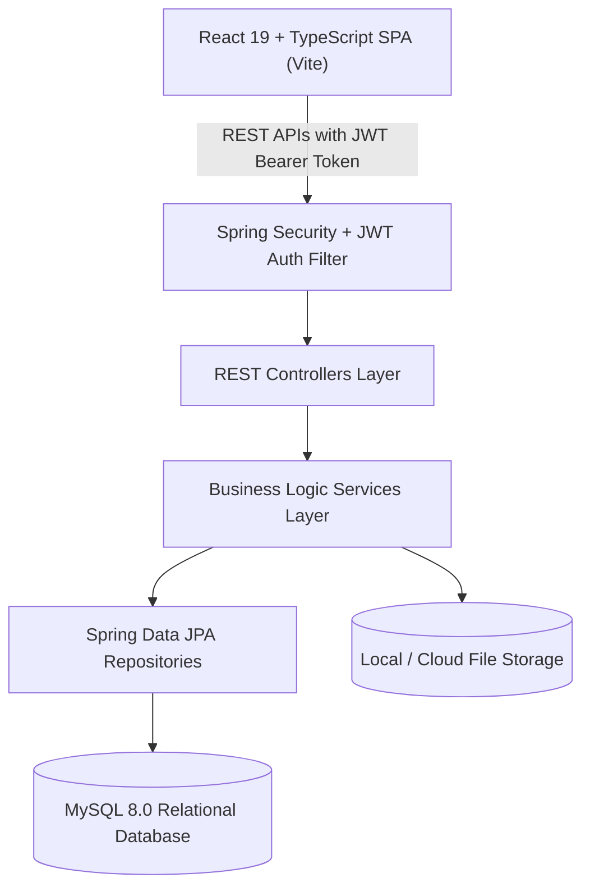

# System Architecture & Technical Specifications

## 1. High-Level Architecture
The Student Management System (SMS) is architected as a layered, decoupling client-server enterprise application.

## 2. Technology Stack Breakdown
### Frontend
- **Framework**: React 19 + TypeScript
- **Bundler & Tooling**: Vite
- **Routing**: React Router v6
- **State & HTTP**: Axios with Interceptors, React Hooks, AuthContext
- **Form Handling**: React Hook Form with Zod validation
- **Styling**: Tailwind CSS + Modern Custom UI Design System
- **Icons**: Lucide React
- **Visual Analytics**: Recharts

### Backend
- **Framework**: Java 20+, Spring Boot 3.3.x
- **Security**: Spring Security 6 with Stateless JWT Filter, BCrypt Password Encoder
- **Persistence**: Spring Data JPA, Hibernate ORM
- **Validation**: Jakarta Bean Validation API
- **Build & Dependency Management**: Maven Wrapper (`mvnw`)
- **Productivity**: Lombok

### Database & Storage
- **RDBMS**: MySQL 8.0 with InnoDB engine, utf8mb4 charset
- **Connection Pool**: HikariCP
- **File Assets**: Uploaded documents and submission attachments stored on isolated disk paths with database references

## 3. Security Architecture
1. **Stateless Authentication**: JWT tokens signed using HMAC-SHA256 with expiration and role claims.
2. **Role-Based Access Control (RBAC)**: Backend endpoint protection using `@PreAuthorize("hasRole('ADMIN')")`, `@PreAuthorize("hasAnyRole('TEACHER','ADMIN')")`, etc.
3. **CORS Configuration**: Explicit origin whitelist with credential support.
4. **Credential Safety**: All passwords hashed using BCrypt (strength 10). Sensitive settings configurable through environment variables (`DB_URL`, `DB_USERNAME`, `DB_PASSWORD`, `JWT_SECRET`).
5. **Audit Logging**: Every sensitive mutation (user creation, grade entry, attendance, result publishing) writes to an append-only `audit_logs` record.
