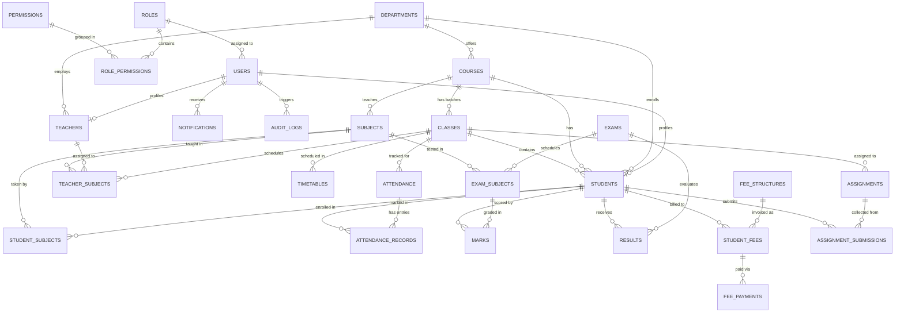

# Entity Relationship (ER) Documentation & Diagrams

## Entity Relationship Overview

The Student Management System uses a 3NF normalized relational schema designed for institutional scalability and referential integrity.

## Key Entities & Relationship Rules
1. **Users & Profiles**: `users` is the authentication principal. One-to-One with `students` and `teachers`. Deleting a user cascades to profile, but business records retain academic history.
2. **Attendance Integrity**: Composite unique key `(class_id, subject_id, attendance_date)` guarantees only one roll-call session per subject per date per class.
3. **Marks Integrity**: `(exam_subject_id, student_id)` composite unique key prevents duplicate score records.
4. **Fees Structure**: Distinct `fee_structures` per course/semester, generating individual `student_fees` ledgers with transactional `fee_payments` tracking.
5. **Timetable Conflict Avoidance**: Room, Teacher, and Class indexed by `(day_of_week, start_time)` to enforce conflict-free scheduling.
